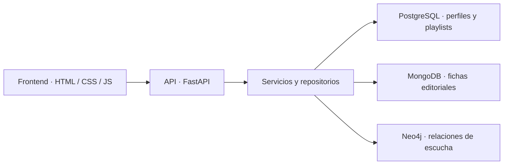

# SoundGraph

**Descubrimiento musical explicable mediante tres modelos de bases de datos.**

SoundGraph es un proyecto académico que recomienda canciones a partir de escuchas compartidas y explica el motivo de cada sugerencia. Permite consultar la ficha de una canción y guardarla en una playlist.

## ¿Cómo funciona?

1. Entra con un perfil de demostración.
2. Consulta canciones sugeridas y el número de perfiles con escuchas en común.
3. Abre una ficha y consulta sus créditos y notas disponibles.
4. Guarda una canción en una playlist y vuelve a abrirla para comprobar su persistencia.

En **Mis playlists** puedes crear, renombrar o eliminar una lista, quitar pistas y guardar un nuevo orden. El rol **Editor** dispone de la sección **Editorial** para elegir una ficha, editar sus notas y fuentes o añadir una nota.

## Arquitectura

El proyecto utiliza una aplicación organizada por capas: el frontend se comunica por HTTP con una API FastAPI; los servicios coordinan operaciones y los repositorios acceden a los motores. El frontend y la API se sirven desde el mismo origen.



## Estructura

| Carpeta | Contenido |
| --- | --- |
| `frontend/` | Interfaz y recursos web |
| `backend/` | API, servicios y repositorios |
| `database/` | Esquemas, consultas y datos de demostración |
| `scripts/` | Inicialización, carga, auditoría y medición |
| `tests/` | Pruebas unitarias, HTTP y de integración |
| `docs/` | Entregables, contrato API y evidencias |

## Arranque local

Requisitos: Docker en ejecución con Compose v2 y Python 3 para crear las credenciales locales. Las bases no publican puertos en el host. La API se publica por defecto solo en `127.0.0.1:8000`. Los proyectos de desarrollo y pruebas tienen redes y volúmenes separados.

```sh
python3 -m scripts.init_env
docker compose -p soundgraph-dev up -d --wait postgres mongo neo4j
docker compose -p soundgraph-dev build tools api
docker compose -p soundgraph-dev run --rm --no-deps tools
docker compose -p soundgraph-dev run --rm --no-deps tools python -m scripts.check_references
docker compose -p soundgraph-dev up -d --no-deps --wait api
```

El primer comando genera `.env` y `.env.demo` con permisos privados si no existen. No publiques ninguno ni reemplaces las credenciales de los motores mientras reutilizas sus volúmenes. Para probar la interfaz, abre [SoundGraph](http://127.0.0.1:8000/) y elige **Ana** con el valor local de `DEMO_CODE_ANA` en `.env.demo`. No compartas ese valor. Para probar Swagger, abre [localhost:8000/docs](http://127.0.0.1:8000/docs) y sigue la [guía de la API](docs/api/README.md).

El cargador prepara los tres esquemas y toma los datos de [`demo.json`](database/fixtures/demo.json). Ejecuta los [scripts SQL de carga](database/postgres/seed/) y los [scripts Cypher de carga](database/neo4j/seed/) con parámetros y aplica el [validador de MongoDB](database/mongo/song_validator.json). Puedes ejecutarlo de nuevo: no duplica los registros de la semilla ni reemplaza una ficha o playlist editada. Si una dependencia falla durante la carga, no existe una transacción global; corrige el problema y repite el comando para completar lo que quedó pendiente. La auditoría devuelve **0** si las referencias son correctas, **1** si detecta inconsistencias o **2** si no pudo comprobarlas.

## Pruebas sobre tres motores reales

Las [pruebas unitarias](tests/unit/) no requieren motores activos. Desde la raíz y tras ejecutar `python3 -m scripts.init_env`:

```sh
docker compose -p soundgraph-test build tools
docker compose -p soundgraph-test run --rm --no-deps tools \
  python -m pytest -p no:cacheprovider -q tests/unit
```

Para las pruebas de integración, usa el proyecto de pruebas y su propia semilla; algunos casos introducen datos temporales.

```sh
docker compose -p soundgraph-test up -d --wait postgres mongo neo4j
docker compose -p soundgraph-test build tools
docker compose -p soundgraph-test run --rm --no-deps tools
docker compose -p soundgraph-test run --rm --no-deps \
  -e SOUNDGRAPH_ISOLATED_TEST=1 tools python -m pytest -p no:cacheprovider -q tests/integration
docker compose -p soundgraph-test run --rm --no-deps tools python -m scripts.check_references
docker compose -p soundgraph-test down
```

Para detener desarrollo conservando sus datos, ejecuta `docker compose -p soundgraph-dev down`. No uses `down -v` si necesitas conservar el conjunto de datos. Para ensayar un arranque limpio sin borrar volúmenes, usa un nombre de proyecto nuevo.

La [guía de la API](docs/api/README.md) tiene la prueba HTTP aislada, incluidos los casos de ficha faltante, fallo de Neo4j y dos guardados simultáneos.

## Documentación de entrega

- [Índice vigente de los ocho entregables y sus evidencias](docs/entregables.md)
- [Recorrido para instalar y demostrar la aplicación](docs/demostracion.md)
- [Modelo integrado y diccionario de datos](docs/models/modelado-integrado.md)
- [Arquitectura y selección tecnológica](docs/arquitectura.md)
- [Qué usa cada base y cuándo intervienen los archivos del proyecto](docs/mapa-del-proyecto.md)
- [Catálogo de operaciones y consultas](docs/catalogo-operaciones.md)
- [Validación de entrega y medición HTTP del 22 de noviembre](docs/evidence/2026-11-22-verificacion-entrega.md)
- [Cierre de candidata, reproducibilidad y pruebas actualizadas](docs/evidence/2026-11-27-cierre-candidata.md) · [índice de entregables](docs/entregables.md) · [pendientes de cierre](docs/seguimiento-cierre.md)
- [Verificación en navegador: descubrimiento y guardado](docs/evidence/2026-11-21-h1-frontend.md) y [gestión de playlists y notas](docs/evidence/2026-11-21-h2-frontend.md)

**Documentos históricos de trabajo:** [diseño del MVP](docs/superpowers/specs/2026-11-21-soundgraph-mvp-design.md) y [plan de implementación](docs/superpowers/plans/2026-11-21-soundgraph-mvp-implementation.md). Para conocer lo implementado y probado, usa el índice vigente.
