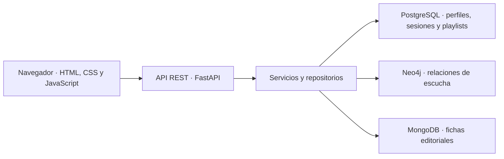

# SoundGraph

**Recomendaciones musicales con una explicación: cuántos oyentes con escuchas en común ya escucharon la canción.**

SoundGraph es un proyecto integrador de **Bases de Datos en la Nube**. En una sola aplicación web puedes descubrir una canción, consultar su ficha y guardarla en una playlist. PostgreSQL conserva perfiles, sesiones y playlists; Neo4j calcula sugerencias a partir de las escuchas; MongoDB aporta las fichas editoriales.

[Arranque local](#arranque-local) · [Demo paso a paso](#demostración) · [Resultados](#resultados-verificados) · [Ocho entregables](docs/entregables.md)

## Arranque local

Necesitas **Docker en ejecución con Compose v2** y **Python 3** para generar la configuración local. La primera ejecución requiere conexión para descargar las imágenes y dependencias. Si ya tienes el repositorio, omite los dos primeros comandos y trabaja desde su raíz.

```sh
git clone https://github.com/ArturoYJ/soundgraph.git
cd soundgraph
python3 -m scripts.init_env
docker compose -p soundgraph-dev up -d --wait postgres mongo neo4j
docker compose -p soundgraph-dev build tools api
docker compose -p soundgraph-dev run --rm --no-deps tools
docker compose -p soundgraph-dev run --rm --no-deps tools python -m scripts.check_references
docker compose -p soundgraph-dev up -d --no-deps --wait api
```

| Abre en el navegador | Qué encontrarás |
| --- | --- |
| [Aplicación web](http://127.0.0.1:8000/) | Acceso, descubrimiento, playlists y edición según el rol. |
| [Estado de la API](http://127.0.0.1:8000/health/ready) | HTTP 200 con `{"status":"ok"}` si las tres dependencias están listas. |
| [Swagger UI](http://127.0.0.1:8000/docs) · [OpenAPI activo](http://127.0.0.1:8000/openapi.json) | Documentación interactiva y contrato JSON de la API. |

`scripts.init_env` genera `.env` y `.env.demo` locales con permisos privados si no existen. **No compartas esos archivos ni los valores que contienen.** El repositorio incluye [una plantilla sin credenciales](.env.example). Por defecto, la API se publica solo en `127.0.0.1:8000` y las bases no exponen sus puertos al equipo anfitrión.

El cargador prepara los esquemas, aplica el [validador de MongoDB](database/mongo/song_validator.json) y carga los [datos de ejemplo](database/fixtures/demo.json) mediante SQL, MongoDB y Cypher. Repetirlo no duplica la semilla ni sobrescribe una ficha o playlist editada. Si falla una dependencia, corrige la causa, repite la carga y vuelve a ejecutar la auditoría. La auditoría devuelve `0` sin inconsistencias, `1` si detecta inconsistencias y `2` si no puede comprobarlas.

Para detener la demo **sin borrar datos**, usa `docker compose -p soundgraph-dev down` sin `-v`. Para ensayar desde cero con datos separados, usa otro nombre de proyecto y, si el puerto está ocupado, configura `SOUNDGRAPH_API_PORT` y abre la aplicación en ese puerto. No cambies las credenciales de motores cuyos volúmenes vas a reutilizar.

## Demostración

1. En **Demo / Editor**, elige **Ana** e introduce el valor local de `DEMO_CODE_ANA` desde `.env.demo`.
2. En **Descubrir**, busca **C.R.E.A.M.**. La afinidad es de **un perfil**: aunque ese perfil comparte dos canciones escuchadas con Ana, se cuenta una sola vez.
3. Pulsa **Ver ficha** para leer el título, los créditos y las notas disponibles.
4. Guarda la canción en **Para escuchar**, abre la playlist y recarga. La pista permanece; guardarla otra vez no la duplica.

En **Mis playlists** puedes crear, renombrar, reordenar o eliminar listas y quitar pistas. El rol **Editor** puede actualizar notas y fuentes desde **Editorial**. En **Crear perfil** puedes abrir un perfil personal y luego volver a entrar desde **Mi código**; un perfil nuevo todavía no tiene historial de escucha. Consulta el [guion de demostración](docs/demostracion.md) para preparar los datos y ensayar estos recorridos.

## Arquitectura

La interfaz web habla por HTTP con FastAPI desde el mismo origen. La API valida las solicitudes, los servicios coordinan las operaciones y los repositorios encapsulan las consultas a cada motor.



Cuando Ana abre **Descubrir**, PostgreSQL valida su sesión, Neo4j obtiene las candidatas y MongoDB devuelve las fichas disponibles. Guardar consulta la ficha y escribe la entrada de playlist únicamente en PostgreSQL. Los motores se relacionan por identificadores: no hay claves foráneas ni transacciones distribuidas entre ellos. Véanse la [arquitectura](docs/arquitectura.md) y el [modelo integrado](docs/models/modelado-integrado.md).

## Resultados verificados

| Comprobación | Qué se observó | Evidencia |
| --- | --- | --- |
| Reproducción desde una copia limpia | Tres motores iniciados, semilla cargada, auditoría sin incidencias, disponibilidad HTTP 200 y OpenAPI coincidente. **70 unitarias, 21 de integración y 11 HTTP** aprobadas en el proyecto de prueba. | [Registro de reproducción](docs/evidence/2026-11-28-repro-main-clean.log) |
| Integración web en escritorio | Recorrido de Ana, gestión de playlists, edición de una nota y acceso personal con códigos válidos e inválidos. | [Recorridos web y límites](docs/entregables.md#cómo-leer-las-evidencias) |
| Evaluación ampliada | **600/600** escenarios de grafo y **24/24** escenarios de API esperados; **900** solicitudes HTTP secuenciales medidas. Son comprobaciones distintas. | [Método, resultados y muestras](docs/evidence/2026-11-27-fb24f-evaluacion-ampliada.md) |

El prototipo usa escuchas sintéticas. No reproduce audio ni registra nuevas escuchas desde la interfaz. Las mediciones no demuestran afinidad musical real, concurrencia ni capacidad de producción. El despliegue documentado es local.

## Cómo ejecutar las pruebas

Ejecuta desde la raíz después de `python3 -m scripts.init_env`. Las [pruebas unitarias](tests/unit/) de Python no necesitan los motores activos:

```sh
docker compose -p soundgraph-test build tools
docker compose -p soundgraph-test run --rm --no-deps tools \
  python -m pytest -p no:cacheprovider -q tests/unit
```

Para las [pruebas de integración](tests/integration/), usa los volúmenes de prueba: algunos casos escriben datos temporales.

```sh
docker compose -p soundgraph-test up -d --wait postgres mongo neo4j
docker compose -p soundgraph-test build tools
docker compose -p soundgraph-test run --rm --no-deps tools
docker compose -p soundgraph-test run --rm --no-deps \
  -e SOUNDGRAPH_ISOLATED_TEST=1 tools python -m pytest -p no:cacheprovider -q tests/integration
docker compose -p soundgraph-test run --rm --no-deps tools python -m scripts.check_references
docker compose -p soundgraph-test down
```

La [guía de pruebas HTTP](docs/api/README.md#prueba-http-aislada) indica cómo levantar el proyecto aislado en el puerto requerido. La suite comprueba, entre otros casos, guardados simultáneos, ausencia de fichas y recuperación de Neo4j; no debe ejecutarse contra el entorno de desarrollo.

## Documentación de entrega

- [Índice de los ocho entregables](docs/entregables.md): propuesta, modelos, arquitectura, implementación, catálogo, backend, integración y pruebas.
- [Catálogo de operaciones](docs/catalogo-operaciones.md) y [contrato OpenAPI versionado](docs/api/openapi.json): **18 operaciones en 12 rutas**.
- [Seguimiento de cierre](docs/seguimiento-cierre.md): qué se comprobó y qué queda fuera del alcance.
- [Evidencia histórica y antecedentes](docs/evidence/anteriores.md): ejecuciones y planes previos, separados de los resultados de cierre.

### Estructura del repositorio

| Carpeta | Contenido |
| --- | --- |
| [`frontend/`](frontend/) | Interfaz web. |
| [`backend/`](backend/) | Rutas, servicios y repositorios. |
| [`database/`](database/) | Esquemas, consultas y semilla. |
| [`scripts/`](scripts/) | Configuración local, carga, auditoría y evaluación. |
| [`tests/`](tests/) | Pruebas de componentes, integración y HTTP. |
| [`docs/`](docs/) | Entregables, guías y registros de ejecución. |

El [mapa del proyecto](docs/mapa-del-proyecto.md) explica en qué momento intervienen los archivos durante el recorrido.
