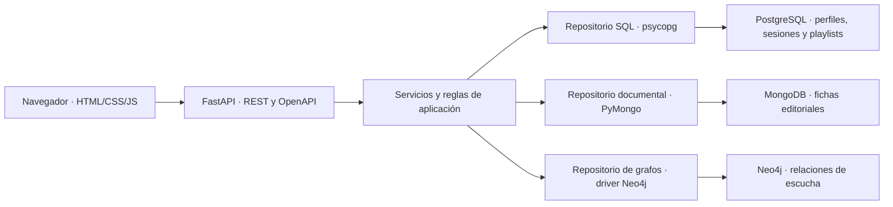
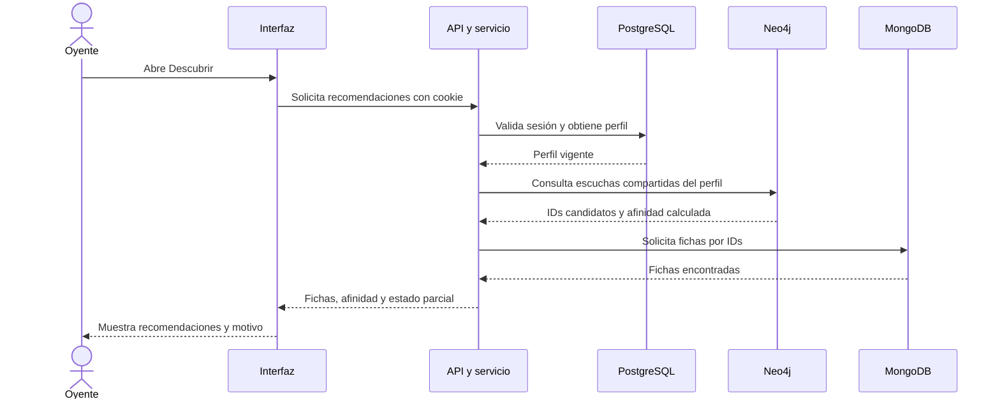

# SoundGraph — Arquitectura y decisión tecnológica

La interfaz web consume una API del mismo origen. FastAPI recibe la solicitud y aplica autenticación y validación; los servicios coordinan los casos de uso y los repositorios encapsulan el acceso a cada motor. Separar `frontend/` de `backend/` organiza el código sin convertir la aplicación en microservicios.

[Entradas HTTP y composición](../backend/main.py) · [Servicios](../backend/services/) · [Repositorios](../backend/repositories/) · [Versiones de dependencias](../requirements.lock.txt) · [Imágenes fijadas en Compose](../compose.yaml).

## Flujo integrado de recomendación

Este recorrido muestra la operación `GET /api/v1/recommendations` con una sesión válida. El diagrama sigue el orden de las lecturas; las flechas de retorno indican resultados, no copias permanentes de los datos.

La afinidad **se calcula en la consulta**, contando perfiles distintos; no es una propiedad almacenada. Si falta una ficha, la API omite esa candidata y marca `partial: true`. Si una dependencia necesaria falla, responde `503` en vez de simular una lista vacía. Véase [Cypher](../database/neo4j/queries/recommendations.cypher) y [servicio](../backend/services/discovery.py).

## Matriz comparativa

La comparación es de **adecuación al caso de uso**; no se ejecutó un benchmark entre tecnologías. Las alternativas muestran qué se tendría que cambiar, no que sean incapaces de cubrir el caso.

| Componente | Elegido | Alternativa considerada | Criterio y decisión |
| --- | --- | --- | --- |
| Datos transaccionales | PostgreSQL | Guardar playlists como documentos | Claves foráneas, unicidad de pista y de posición y transacciones sobre las entradas. El diseño en documentos requeriría replantear el control de propiedad y del orden. Véanse las [restricciones de PostgreSQL](https://www.postgresql.org/docs/17/ddl-constraints.html). |
| Fichas editoriales | MongoDB | Tablas normalizadas para créditos y notas | Una lectura obtiene la ficha y sus secciones anidadas; las secciones pueden variar sin omitir la validación. En tablas sería posible, pero habría que componer la ficha a partir de varias relaciones. Véase la [validación de MongoDB](https://www.mongodb.com/docs/v8.0/core/schema-validation/). |
| Afinidad por escuchas | Neo4j Community + Cypher | Tabla de escuchas y uniones SQL | El caso de uso se expresa como un patrón entre perfiles y canciones. También puede resolverse en SQL; se eligió el grafo para modelar y consultar el patrón de forma explícita, no por una ventaja de velocidad medida. Véase [MATCH en Cypher](https://neo4j.com/docs/cypher-manual/5/clauses/match/). |
| API | REST con FastAPI | GraphQL | Los recursos y operaciones están delimitados; no se necesita selección arbitraria de campos ni un esquema de resolvers. REST permite seguir los códigos HTTP de alta, guardado idempotente y error; FastAPI genera el contrato OpenAPI a partir de los modelos. Véanse las [características de FastAPI](https://fastapi.tiangolo.com/features/). |
| Interfaz | HTML, CSS y JavaScript sin framework | SPA con framework y compilación separada | El flujo principal requiere pocas vistas y formularios. Servir los recursos desde FastAPI elimina un paso de build frontend y mantiene el mismo origen para la sesión de demo. |
| Ejecución | Docker Compose local | Instalar cada motor manualmente | Permite replicar el conjunto de versiones, redes y volúmenes; los entornos de desarrollo y prueba no comparten datos. |

## Fuentes de verdad y consistencia

PostgreSQL es la autoridad de identidad, sesiones y playlists; MongoDB, del catálogo y notas editoriales; Neo4j, de las relaciones de escucha. `profileId` y `songId` enlazan las representaciones. No se sincronizan copias editables de nombres o fichas: se consultan en origen.

| Dato | Fuente oficial | Referencia en otro motor | Comprobación |
| --- | --- | --- | --- |
| Perfil y sesión | PostgreSQL | `Perfil.profileId` en Neo4j | La auditoría compara nodos de perfil con PostgreSQL. |
| Ficha de canción | MongoDB | `Cancion.songId` en Neo4j y `playlist_tracks.song_id` en PostgreSQL | La auditoría compara ambas referencias con MongoDB; antes de guardar se consulta la ficha. |
| Escucha | Neo4j | IDs de perfil y canción | La semilla valida los extremos y carga la relación dirigida. |
| Playlist y orden | PostgreSQL | Cada pista referencia un ID de ficha | PostgreSQL aplica propiedad, unicidad y transacciones; la API consulta MongoDB al mostrar los datos de la ficha. |

Las referencias entre motores son **lógicas**, no claves foráneas distribuidas. La auditoría detecta identificadores ausentes o huérfanos en las referencias descritas; la cardinalidad y dirección del grafo se verifican en una [prueba separada](evidence/2026-11-22-verificacion-entrega.md#cardinalidad-y-dirección-en-neo4j).

Al recomendar, PostgreSQL valida la sesión, Neo4j busca candidatos y MongoDB devuelve las fichas en bloque. Si falta una ficha, se omite esa recomendación y se indica resultado parcial; si un motor necesario no está disponible, la API reporta indisponibilidad en lugar de presentar una lista vacía. Al guardar se verifica la ficha, pero la única escritura es la de la playlist en PostgreSQL. Editar una nota escribe solo en MongoDB. No hay confirmación ni reversión distribuida. La carga puede quedar parcial si falla una dependencia; se corrige, se repite la carga y se ejecuta la auditoría de referencias.

### Alta personal y fallo del grafo

En la versión con perfiles personales, PostgreSQL confirma el perfil, el acceso y la sesión; después se intenta crear el nodo de Neo4j. Si esa escritura falla, `graph_pending` conserva el trabajo pendiente para reintento idempotente desde el acceso o las recomendaciones. Una respuesta de alta con `graphPending: true` no significa que ambas escrituras hayan terminado. H10 de la [validación aislada](evidence/2026-11-27-cierre-candidata.md) ejercitó la caída y reconciliación. No existe una transacción distribuida.

[Modelo y diccionario](models/modelado-integrado.md) · [Catálogo y resultados](catalogo-operaciones.md).
