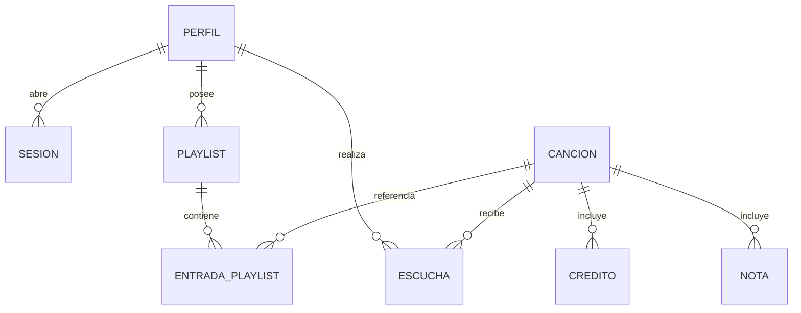
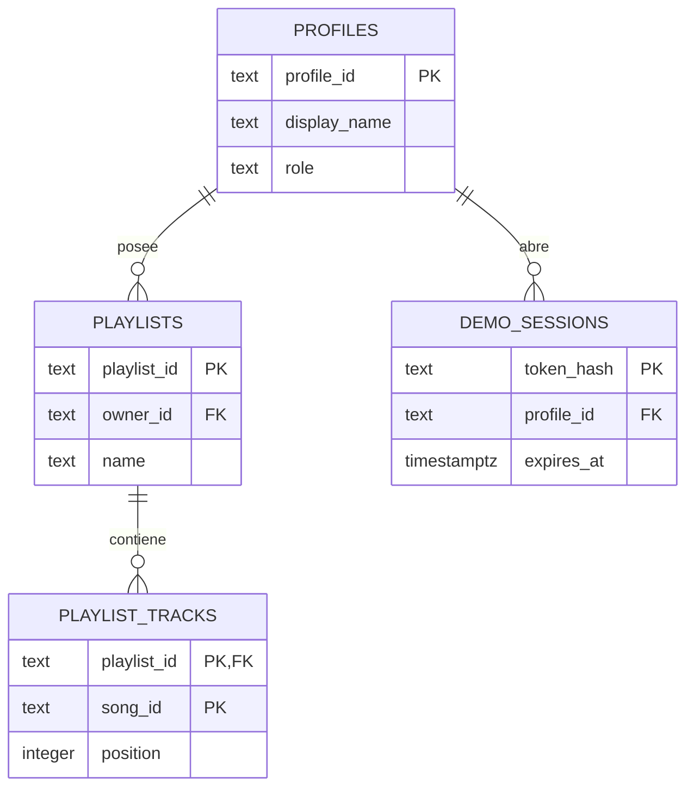
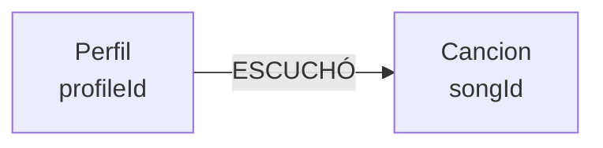

# SoundGraph — Modelado y diccionario de datos

Este documento describe el **integrador actual**. No reutiliza el esquema de la práctica histórica como si fuera el esquema en ejecución. Las fuentes físicas son el [DDL inicial de PostgreSQL](../../database/postgres/001_schema.sql), el [DDL de sesiones](../../database/postgres/002_demo_sessions.sql), el [validador MongoDB](../../database/mongo/song_validator.json), el [esquema de Neo4j](../../database/neo4j/001_schema.cypher) y la [semilla sintética](../../database/fixtures/demo.json).

## Modelo conceptual común

Un perfil escucha canciones, posee playlists y accede a la demo mediante sesiones. Cada canción del catálogo tiene una ficha con título y al menos una sección editorial. Una playlist contiene entradas ordenadas; una entrada referencia una canción, no copia su ficha. Una recomendación se **calcula**, no es una entidad persistida.



La ficha es la representación documental de la canción, no una entidad física separada. Créditos y notas son opcionales por separado, pero debe existir al menos una de esas secciones. Las relaciones con Canción en el diagrama son conceptuales: **no hay claves foráneas entre motores**.

## Relacional — PostgreSQL

El siguiente diagrama muestra las relaciones físicas dentro de PostgreSQL. La referencia de `song_id` a la ficha de MongoDB se explica debajo de la tabla: no es una clave foránea SQL.



Identificadores de perfil, playlist y canción: texto de 1–64 caracteres; empiezan por letra ASCII o dígito y admiten guiones tras el primer carácter. Todos los campos de esta tabla de diccionario son obligatorios.

| Tabla | Campo | Tipo y reglas |
| --- | --- | --- |
| `profiles` | `profile_id` | `text`, clave primaria. Identidad oficial del perfil. |
| | `display_name` | `text`, 1–100 caracteres tras recortar extremos. Nombre visible. |
| | `role` | `text`, `listener` o `editor`. |
| `playlists` | `playlist_id` | `text`, clave primaria. |
| | `owner_id` | `text`, FK a `profiles.profile_id`. Una playlist tiene un propietario; un perfil puede tener cero o más playlists. |
| | `name` | `text`, 1–100 caracteres tras recorte. No es único. |
| `playlist_tracks` | `playlist_id` | `text`, FK con borrado en cascada a `playlists`. |
| | `song_id` | `text`, referencia lógica a MongoDB `songs._id`. Junto con `playlist_id` forma la clave primaria; una canción no se repite en la misma playlist. |
| | `position` | `integer` positivo; único dentro de la playlist. Restricción diferible para intercambiar posiciones dentro de una transacción. |
| `demo_sessions` | `token_hash` | `text`, clave primaria de 64 caracteres. El servicio almacena el SHA-256 del token, no el token en claro. |
| | `profile_id` | `text`, FK a `profiles.profile_id` con borrado en cascada. |
| | `expires_at` | `timestamptz`. El servicio emite sesiones de ocho horas y solo acepta las vigentes. |

**Índices.** La PK compuesta apoya búsquedas por playlist y canción; el índice único de `(playlist_id, position)` garantiza posiciones distintas y permite recuperar el orden. `playlists_owner_idx` corresponde al listado por propietario y `demo_sessions_expiry_idx` al retiro de sesiones vencidas. Son justificaciones por patrón de acceso, no prueba de que el planificador use los índices con la semilla mínima.

## Documental — MongoDB

La estructura siguiente muestra una ficha; `credits` y `notes` son secciones opcionales por separado, pero al menos una debe existir y cada arreglo presente debe contener elementos.

```text
songs (colección)
└── documento de canción
    ├── _id: identificador de canción
    ├── title: título
    └── editorial
        ├── credits[]: { name, role }
        └── notes[]:   { text, source }
```

Colección `soundgraph.songs`; validación `strict`, acción `error`. Se rechazan campos fuera de los admitidos por el validador. El índice único de `_id` es suficiente para la búsqueda por canción y la hidratación en bloque con `$in`; no se añadió un índice para notas o créditos porque no se filtra por ellos.

| Ruta | Tipo y reglas |
| --- | --- |
| `_id` | Cadena obligatoria con el formato de identificador. Es la fuente oficial de `songId`. |
| `title` | Cadena obligatoria, 1–160 caracteres y al menos un carácter que no sea espacio en blanco. |
| `editorial` | Objeto obligatorio con al menos una sección admitida: `credits` o `notes`. |
| `editorial.credits[]` | Si existe, arreglo no vacío de objetos con `name` (cadena 1–160) y `role` (1–100). |
| `editorial.notes[]` | Si existe, arreglo no vacío de objetos con `text` (cadena 1–1000) y `source` (1–200); ambos deben contener al menos un carácter que no sea espacio en blanco. |

Los límites de entrada de la **API** son independientes del validador de almacenamiento: la edición requiere entre 1 y 20 notas y recorta sus textos y fuentes antes de validar. Cambia únicamente la sección de notas.

## Grafo — Neo4j



La flecha indica la dirección de la relación. Las propiedades enlazan lógicamente con los datos oficiales de PostgreSQL y MongoDB; el diagrama no afirma que Neo4j haga cumplir esas referencias entre motores.

| Elemento | Propiedades, dirección y cardinalidad |
| --- | --- |
| Nodo `Perfil` | `profileId`: referencia a `profiles.profile_id`. Restricción de unicidad de Neo4j sobre la propiedad. |
| Nodo `Cancion` | `songId`: referencia a `songs._id`. Restricción de unicidad de Neo4j sobre la propiedad. |
| Relación `ESCUCHÓ` | De `Perfil` hacia `Cancion`, sin propiedades en la semilla. Un perfil puede tener cero o muchas canciones escuchadas; una canción, cero o muchos perfiles oyentes. Se espera una relación por par en la carga. |

La carga valida referencias y pares antes de escribir y usa `MERGE`. Las restricciones de unicidad respaldan con índices los accesos por identificador, pero **no obligan por sí solas a que la propiedad exista ni limitan la multiplicidad de relaciones**. La auditoría detecta identificadores ausentes y referencias huérfanas; no comprueba toda la cardinalidad del grafo. La [consulta de recomendación](../../database/neo4j/queries/recommendations.cypher) excluye canciones ya escuchadas y usa `count(DISTINCT similar)` para contar perfiles, no caminos.

## Reglas entre motores

- PostgreSQL es autoridad de perfiles, sesiones y playlists; MongoDB, de las fichas; Neo4j, de las relaciones de escucha.
- No se replica contenido editable. Se cruzan identificadores; el backend valida la existencia de la ficha antes de guardar una entrada en SQL.
- La [auditoría](../../scripts/check_references.py) comprueba nodos de perfil contra SQL, nodos de canción y pistas de playlist contra MongoDB. No hay transacción distribuida. Se cargan los motores en orden, se verifica la coherencia y se puede repetir la carga si falla.
- La semilla contiene 4 perfiles, 1 playlist sin pistas, 3 fichas y 5 relaciones. Los perfiles, las escuchas y la nota de prueba son sintéticos.
